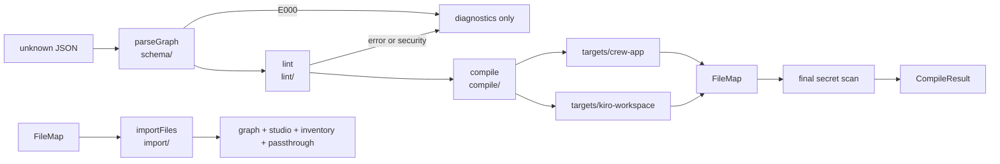

# Design Document

## Overview

`@grimoire-crew/core` turns a Grimoire_Graph into real Kiro and Kiro Crew files and back. It is a pure TypeScript library: data in, data out. Everything else in GrimoireCrew (the studio, the server, the Crew app, the curse engine) calls these four functions:

| Function | Input | Output |
|---|---|---|
| `parseGraph(input)` | unknown JSON | `{ ok, graph, diagnostics }` |
| `lint(graph, { target })` | Grimoire_Graph | `Diagnostic[]` |
| `compile(input, { target, studio? })` | unknown JSON | `{ ok, files, diagnostics }` |
| `importFiles(files, { slug? })` | FileMap | `{ graph, studio, inventory, passthrough, diagnostics }` |

Three ideas carry the design:

1. **The SOP file is the index.** Every compiled package contains one SOP, and its tables hold the graph's metadata, topology, and every field that has no other home. The importer reads the SOP first and fills in details from the agent, skill, MCP, and hook files. One parser therefore serves both targets.
2. **Determinism by construction.** Writers take explicit key orders, every list has a defined sort, and nothing reads the clock, randomness, or the environment. Golden snapshots and property tests prove it.
3. **Security is a compile gate.** The linter scans every string for secret patterns before anything is emitted, and the compiler scans every emitted file again. Any finding makes `compile` return no files.

Decisions behind this design: D-006 to D-010, D-013, D-014, D-020 to D-024 in `docs/decisions.md`.

## Architecture



Source layout of `packages/core/src`:

```text
index.ts                 public API (Requirement 17.4)
diagnostics/
  catalog.ts             DIAGNOSTIC_CATALOG and the Diagnostic type
  sort.ts                canonical diagnostic order
schema/
  ids.ts                 slug and id rules, name builders
  graph.ts               node and graph Zod schemas, parseGraph, normalize
  studio.ts              Studio_Sidecar schema
contracts/
  app-manifest.ts  agent.ts  hooks.ts  mcp.ts  skill.ts  steering.ts
lint/
  edge-matrix.ts         allowed (source, target) type pairs
  structural.ts          GC-E001..E012, W001, W002, W004, W007
  security.ts            GC-S001..S003, W005, W006
  secret-patterns.ts     Secret_Pattern list and findSecret()
  target.ts              target-specific W003, I001..I003
  index.ts               lint()
write/
  json.ts                ordered JSON writer
  front-matter.ts        YAML front matter writer and reader
  table.ts               Markdown table cell codec, table writer and reader
  file-map.ts            sorted FileMap builder and path checks
compile/
  index.ts               compile()
  context.ts             derived lookups: neighbours, handoff order, hosts
  agents.ts              conductor and worker agent JSON
  prompts.ts             prompt templates and their parsers
  skills.ts              SKILL.md
  sop.ts                 SOP Markdown and its parser
  ward-guard.ts          renderWardGuard()
  targets/crew-app.ts
  targets/kiro-workspace.ts
import/
  index.ts               importFiles()
  paths.ts               path normalization, env-file filter
  detect.ts              target and grimoire detection
  assemble.ts            graph assembly from parsed files
  inventory.ts           existing Kiro state
  layout.ts              deterministic layered auto-layout
presets/
  skill-templates.ts     4 built-in skill templates
  pr-exorcist-coven.ts  thesis-alchemist.ts  bug-necromancer.ts
  index.ts
```

Dependencies: `zod` (v4) and `yaml` only (Requirement 17). Tests live in `packages/core/test/` and may use Node APIs.

## Components and Interfaces

```ts
export type Target = 'crew-app' | 'kiro-workspace';
export type FileMap = Record<string, string>;

export type Severity = 'security' | 'error' | 'warning' | 'info';
export interface Diagnostic {
  code: DiagnosticCode;            // e.g. "GC-E004"
  severity: Severity;
  message: string;                 // never contains a secret value
  nodeId?: string;
  edgeId?: string;
  path?: string;                   // JSON path ("nodes[2].persona") or file path
  fix?: Fix;
}
export type Fix =
  | { op: 'delete_edge'; edgeId: string }
  | { op: 'delete_node'; nodeId: string }
  | { op: 'set_field'; nodeId: string; field: string; value: unknown }
  | { op: 'connect_nodes'; source: string; target: string };

export function parseGraph(input: unknown):
  | { ok: true; graph: GrimoireGraph; diagnostics: [] }
  | { ok: false; graph: null; diagnostics: Diagnostic[] };

export function lint(graph: GrimoireGraph, options: { target: Target }): Diagnostic[];

export interface CompileOptions { target: Target; studio?: StudioSidecar }
export interface CompileResult { ok: boolean; files: FileMap; diagnostics: Diagnostic[] }
export function compile(input: unknown, options: CompileOptions): CompileResult;

export interface ImportOptions { slug?: string }
export interface ImportResult {
  graph: GrimoireGraph | null;
  studio: StudioSidecar | null;      // null only when graph is null
  inventory: Inventory;
  passthrough: FileMap;
  diagnostics: Diagnostic[];
}
export function importFiles(files: FileMap, options?: ImportOptions): ImportResult;

export function renderWardGuard(): string;
```

All four entry points catch unexpected exceptions and convert them into a `GC-E000` diagnostic with the message "internal error in <function>", so callers never need `try` (Requirements 6.6 and 15.1).

## Data Models

### Common rules

- `Slug` and node `Id`: `^[a-z0-9]+(?:-[a-z0-9]+)*$`, at most 24 characters. Skill slugs: same pattern, at most 32 characters.
- `Host`: lowercase DNS name, optionally prefixed by `*.`; no scheme, port, or path.
- Every string is normalized by the schema: CRLF becomes LF, then leading and trailing whitespace is trimmed. Required strings must be non-empty after trimming. This makes round-trips exact, because Markdown tables and sections trim whitespace too.
- `persona`, `task`, and `goal` may not contain a line that starts with `## ` (Requirement 1.13).

### Graph

```ts
interface GrimoireGraph {
  schemaVersion: 1;
  slug: Slug;
  displayName: string;
  description: string;
  author: string;
  version: string;                 // X.Y.Z
  nodes: GrimoireNode[];
  edges: { id: Id; source: Id; target: Id }[];
}
```

| Node `type` | Fields (defaults in brackets) |
|---|---|
| `manual_ritual` | `label`, `inputKind`: `prompt` \| `url` \| `text` |
| `cron_ritual` | `label`, `message`, `enabledOnInstall` [false], exactly one of `cron` (5 fields) or `everySeconds` (integer >= 60) |
| `conductor` | `name`, `goal`, `kiroModel?`, `maxSteps` 3..10 [6] |
| `worker_agent` | `mode: "custom"`: `name`, `persona`, `task`, `kiroModel?`, `maxSteps` 3..5 [3], `outputFormat` [`markdown`]; `mode: "reuse"`: `existingAgentName` (1..64 chars, `^[A-Za-z0-9][A-Za-z0-9._-]*$`) |
| `skill_tome` | `slug`, `description`, `template`: `owasp-audit` \| `thesis-review` \| `bug-triage` \| `report-writer` \| `custom`, `body` |
| `builtin_relic` | `relic`: `github_repo_reader` \| `web_page_fetcher` \| `webhook_notifier`, `retry` {`attempts` 0..5 [2], `backoffMs` 0..60000 [1000]}, `fallback` [`skip`], `allowedHosts` [[]] (sorted, unique) |
| `custom_mcp_relic` | `serverName` (slug), `transport`: {`kind: "local"`, `command`, `args` [[]], `env` [{}]} or {`kind: "remote"`, `url`, `headers` [{}]}, `autoApprove` [[]], `disabledTools` [[]] |
| `ward_hook` | `trigger`: `PreToolUse` \| `PostToolUse`, `matcher` [`*`], `promptInjectionFilter` [false], `secretLeakBlocker` [true], `permissionAllowlistGate` [false] |

Every node also has `id`. `worker_agent` is a discriminated union on `mode`; nodes are a discriminated union on `type`.

`normalize(graph)` returns the parsed graph with nodes and edges sorted by `id`. It is the equality used by the round-trip property (P4).

### Studio_Sidecar

```ts
interface StudioSidecar {
  schemaVersion: 1;
  graphSlug: Slug;
  positions: Record<Id, { x: number; y: number }>;   // finite numbers
  viewport: { x: number; y: number; zoom: number };  // zoom > 0
  runtimeModels: Record<Id, string>;                 // OpenRouter model IDs (agents only)
  ritualInputs: Record<Id, string>;                  // manual_ritual default inputs
}
```

Emitted as `grimoire/<slug>.studio.json` in both targets, keys sorted, entries for unknown node IDs dropped.

### Inventory

```ts
interface Inventory {
  agents: { name: string; description: string; path: string }[];
  skills: { name: string; description: string; path: string }[];
  mcpServers: { name: string; kind: 'local' | 'remote'; envKeys: string[]; headerKeys: string[]; path: string }[];
  hooks: { name: string; trigger: string; path: string }[];
  steering: { name: string; inclusion: string; path: string }[];
}
```

Each list is sorted by `path`, then `name`.

## Naming

| Thing | Name | Example (slug `pr-exorcist`, id `auditor`) |
|---|---|---|
| Crew app | `grimoire-<slug>` | `grimoire-pr-exorcist` |
| Agent (conductor or custom worker) | `grimoire-<slug>-<id>` | `grimoire-pr-exorcist-auditor` |
| Skill | `grimoire-<skill slug>` | `grimoire-owasp-audit` |
| SOP | `grimoire-<slug>` | `sops/grimoire-pr-exorcist.md` |
| Cron | `grimoire-<slug>-<id>` | `grimoire-pr-exorcist-nightly` |
| Ward hooks file | `grimoire-<slug>-wards.json` | |
| Sidecar | `grimoire/<slug>.studio.json` | |

The importer recovers a node id by removing the known `grimoire-<slug>-` prefix (D-023).

## Lint Rules

### Edge matrix (Requirement 4.1)

| Source | Allowed targets |
|---|---|
| `manual_ritual`, `cron_ritual` | `conductor`, `worker_agent` |
| `conductor` | `worker_agent`, `skill_tome`, `builtin_relic`, `custom_mcp_relic` |
| `worker_agent` | `skill_tome`, `builtin_relic`, `custom_mcp_relic` |
| `ward_hook` | `conductor`, `worker_agent` |

The matrix makes cycles impossible (no edge enters a trigger or a ward, and no worker points to an agent), so the graph is always a DAG.

### Diagnostic catalog (Requirement 3.3)

| Code | Severity | Meaning | Fix |
|---|---|---|---|
| GC-E000 | error | Input does not match the graph schema (or an internal error) | |
| GC-E001 | error | Duplicate node id | |
| GC-E002 | error | Duplicate edge id | |
| GC-E003 | error | Edge references a missing node | `delete_edge` |
| GC-E004 | error | Edge between node types that cannot connect | `delete_edge` |
| GC-E005 | error | More than one conductor | |
| GC-E006 | error | No trigger node | |
| GC-E007 | error | No agent node | |
| GC-E008 | error | Agent cannot be reached from any trigger | `connect_nodes` from the first trigger, when one exists |
| GC-E009 | error | Duplicate skill slug | |
| GC-E010 | error | Duplicate MCP server name | |
| GC-E011 | error | Conductor has no worker | |
| GC-E012 | error | Cron ritual does not target exactly one agent | |
| GC-E100 | error | Import: no `app.json` and no `.kiro/` files | |
| GC-E101 | error | Import: a grimoire file is not valid JSON or front matter | |
| GC-E102 | error | Import: a grimoire file misses a required heading or section | |
| GC-E103 | error | Import: a SOP row is inconsistent (unknown node, missing agent file) | |
| GC-E104 | error | Import: several grimoires found and no `slug` given | |
| GC-S001 | security | Secret-looking literal in a graph field | |
| GC-S002 | security | MCP `env` or `headers` value without a `${VAR}` placeholder | |
| GC-S003 | security | Remote MCP URL is not `https` (localhost excepted) | |
| GC-S004 | security | Import: secret-looking literal in a foreign file (file dropped) | |
| GC-W001 | warning | Duplicate edge (same source and target) | `delete_edge` (later edge) |
| GC-W002 | warning | Skill, relic, or ward with no edges | `delete_node` |
| GC-W003 | warning | Cron ritual skipped in the `kiro-workspace` target | |
| GC-W004 | warning | Attachment connected to a reuse worker (has no effect) | `delete_edge` |
| GC-W005 | warning | Agent uses a network relic without a permission allowlist gate | |
| GC-W006 | warning | `PostToolUse` ward with blocking toggles (cannot block) | `set_field` trigger `PreToolUse` |
| GC-W007 | warning | Web or webhook relic without `allowedHosts` | |
| GC-W008 | warning | Sidecar slug differs from graph slug (sidecar not emitted) | |
| GC-W009 | warning | Import: sidecar invalid or for another slug (auto-layout used) | |
| GC-I001 | info | Webhook notifier runs only in the GrimoireCrew runtime | |
| GC-I002 | info | Prompt injection filter cannot be enforced in a Crew App export | |
| GC-I003 | info | `iconPath` omitted from `app.json` | |
| GC-I004 | info | Import: foreign file kept unchanged in passthrough | |
| GC-I005 | info | Import: unrecognized field in a grimoire file | |
| GC-I006 | info | Import: env file ignored | |

Diagnostics are sorted by severity (security, error, warning, info), then code, then `nodeId`, then `path` (Requirement 3.5).

### Security scan (Requirement 5)

`findSecret(text)` returns the name of the first matching pattern or `null`. Patterns (the same set as `scripts/lib/secret-patterns.mjs`):

| Name | Pattern |
|---|---|
| canary | `sk-kiro-CANARY-FAKE-[A-Za-z0-9]` |
| sk key | `\bsk-[A-Za-z0-9_-]{20,}` |
| GitHub token | `\bgh[pousr]_[A-Za-z0-9]{20,}` |
| GitHub fine-grained token | `\bgithub_pat_[A-Za-z0-9_]{20,}` |
| AWS access key ID | `\b(?:AKIA\|ASIA)[0-9A-Z]{16}\b` |
| Slack token | `\bxox[abprs]-[A-Za-z0-9-]{10,}` |
| private key | `-----BEGIN [A-Z ]*PRIVATE KEY-----` |
| Discord webhook | `discord(?:app)?\.com/api/webhooks/\d+/[\w-]+` (case-insensitive) |

The linter walks every string in the graph (metadata and all node fields, including map values and arrays) and reports `GC-S001` with the JSON path. A Discord webhook URL is a secret, so a `webhook_notifier` stores only its allowed host (`discord.com`); the URL itself comes from the runtime environment (`GRIMOIRE_WEBHOOK_URL`).

## Compile Pipeline

1. `parseGraph(input)`. On failure return `{ ok: false, files: {}, diagnostics }`.
2. `lint(graph, { target })`. If any diagnostic is `error` or `security`, return `{ ok: false, files: {}, diagnostics }`.
3. Build a `CompileContext`: nodes by id, neighbours by type, the handoff order, effective hosts per agent.
4. Run the target emitter, which returns `[path, text][]`.
5. Validate each JSON or front-matter file against its Contract_Schema. A failure is a bug: return `ok: false` with `GC-E000` "internal error: <path> failed its contract".
6. Run `findSecret` on every file. A match is also a bug and returns `ok: false` with `GC-S001` naming the path.
7. Return `{ ok: true, files: sortedFileMap, diagnostics }`.

### Handoff order (Requirement 9.4)

Kahn's algorithm over the agent subgraph (trigger to agent and conductor to worker edges). Triggers first, sorted by id; then, whenever several agents are ready, the smallest id first. Agents appear once.

### Agent prompts (Requirements 8.2, 8.3)

Worker (custom mode):

```markdown
# {name}

## Persona
{persona}

## Task
{task}

## Output Format
{OUTPUT_SENTENCE[outputFormat]}

## Limits
- Finish within {maxSteps} tool steps.
- Never read, print, or reveal secrets or `.env` files.
```

`OUTPUT_SENTENCE.markdown` = `Respond in Markdown.`; `OUTPUT_SENTENCE.json` = `Respond with one JSON object and no other text.`

Conductor:

```markdown
# {name}

## Goal
{goal}

## Delegation
Delegate to these agents in this order:
{for each worker in handoff order: "- `{agentName}`: {first sentence of task, or 'an existing agent'}"}

Follow the procedure in the SOP `{sopName}`.

## Work Ledger
Keep a Markdown checklist of every delegated item with its owner and status. Update it after each handoff and include it in the final answer.

## Limits
- Finish within {maxSteps} tool steps.
- Never read, print, or reveal secrets or `.env` files.
```

The importer reads `# {name}`, the section bodies of Persona, Task, and Goal, the output sentence, and `Finish within (\d+) tool steps.` It ignores the Delegation and Work Ledger text, which is derived from the topology.

### Agent JSON (Requirement 8)

Key order: `name`, `description`, `prompt`, `model`, `tools`, `excludedTools`, `permissions`, `resources`, `skills`, `includeMcpJson`, `welcomeMessage`. Optional keys are omitted, never written as `null`.

| Key | Value |
|---|---|
| `name` | `grimoire-<slug>-<id>` |
| `description` | Conductor: `Conductor of the {displayName} grimoire.` Worker: `{name} in the {displayName} grimoire.` |
| `prompt` | The rendered prompt |
| `model` | `kiroModel`, only when set |
| `tools` | Built-in IDs sorted (`web_fetch`), then `@<server>` sorted, then `subagent/<name>` sorted (Requirement 8.12) |
| `permissions.rules` | See below |
| `resources` | Workspace target only: the SOP (`file://.kiro/steering/grimoire-<slug>-sop.md`) for the conductor, then `skill://.kiro/skills/grimoire-<s>/SKILL.md` for each skill, sorted |
| `skills` | Crew target only: `grimoire-<s>` for each connected skill, sorted |
| `includeMcpJson` | Crew: `false`. Workspace: `true` when the agent has an MCP relic |
| `welcomeMessage` | `{name} is ready.` |

Permission rules, in this order:

1. Baseline: `fs_read` deny `["**/.env", "**/.env.*"]`, exclude `["**/.env.example"]`.
2. With `secretLeakBlocker`: `fs_read` deny `["**/*.key", "**/*.pem", "**/*secret*"]`, exclude `["**/.env.example"]`.
3. With `permissionAllowlistGate`: `web_fetch` deny `["*"]`, exclude the agent's URL patterns.
4. With network relics: `web_fetch` allow the agent's URL patterns.
5. Conductor with workers: `subagent` allow the worker agent names, sorted.

A host `h` becomes the URL pattern `https://h/*`; `*.example.com` becomes `https://*.example.com/*`. The `github_repo_reader` relic always adds `api.github.com` and `raw.githubusercontent.com` to its configured hosts. A ward's toggles apply to every agent the ward is connected to.

### Skills (Requirement 8.11)

```markdown
---
name: grimoire-{slug}
description: {description}
---

{body}
```

Front matter is written with the `yaml` package (`lineWidth: 0`, plain style when safe, double-quoted otherwise) so descriptions with colons, quotes, or line breaks survive.

### SOP (Requirement 9)

```markdown
# {displayName}

## Grimoire

| Field | Value |
|---|---|
| slug | {slug} |
| version | {version} |
| author | {author} |
| description | {description} |

## Trigger

| id | type | label | input | schedule | message | enabled on install |
|---|---|---|---|---|---|---|

## Agents

| order | id | type | mode | agent |
|---|---|---|---|---|

## Topology

| edge | from | to |
|---|---|---|

## Skills

| id | skill | template |
|---|---|---|

## Relics

| id | kind | server | hosts | retry attempts | backoff ms | fallback | runs in |
|---|---|---|---|---|---|---|---|

## Wards

| id | trigger | matcher | prompt injection filter | secret leak blocker | permission allowlist gate |
|---|---|---|---|---|---|

## Deliverable

{derived text: the conductor's Work Ledger plus each worker's result, with its output format}
```

Rules:

- Rows are sorted by `id`, except Agents, which follow the handoff order. Empty tables keep their header row.
- `schedule` is `cron: <expr>` or `every: <seconds>`. Booleans are `yes` or `no`. Lists such as hosts are comma-separated.
- `agent` is the compiled name for a conductor or custom worker, and `existingAgentName` for a reuse worker.
- `kind` is `github_repo_reader`, `web_page_fetcher`, `webhook_notifier`, or `custom_mcp`. `runs in` is `kiro` or `grimoirecrew-runtime` (webhooks).
- In the `kiro-workspace` target the SOP becomes `.kiro/steering/grimoire-<slug>-sop.md` with front matter `inclusion: manual` (D-009).

Table cell codec (Requirement 9.6): encode `\` as `\\`, `|` as `\|`, `<` as `\<`, and a line break as `<br>`. The decoder reverses this in one pass, so any string, including literal `<br>` text, round-trips. Rows are split on unescaped `|`.

### Crew App target (Requirement 10)

Files: `app.json`, `agents/grimoire-<slug>-<id>.json`, `skills/grimoire-<s>/SKILL.md`, `sops/grimoire-<slug>.md`, and the optional sidecar.

`app.json` key order: `name`, `version`, `displayName`, `description`, `author`, `agents`, `skills`, `sops`, `mcpServers`, `crons`, `permissions`, `platform`. Values:

- `agents`, `skills`, `sops`: emitted paths, sorted (skill entries are directories, for example `skills/grimoire-owasp-audit`).
- `mcpServers`: present only when MCP relics exist, keyed by `serverName`, with keys `command`, `args`, `env` or `url`, `headers`, then `autoApprove`, `disabledTools`.
- `crons`: present only when cron rituals exist. Each is `{ name, cron_expr | every, message, agent, enabled }`, sorted by name. `agent` is the target agent's name.
- `permissions`: `{ "api": [], "events": [], "network": <boolean> }`.
- `platform`: `{ "os": ["macos", "linux", "windows"] }`.

Target diagnostics: `GC-I003` always, `GC-I001` per webhook relic, `GC-I002` per ward with `promptInjectionFilter`.

### Kiro workspace target (Requirement 11)

Files: `.kiro/agents/grimoire-<slug>-<id>.json`, `.kiro/skills/grimoire-<s>/SKILL.md`, `.kiro/steering/grimoire-<slug>-sop.md`, plus `.kiro/settings/mcp.json` when MCP relics exist, `.kiro/hooks/grimoire-<slug>-wards.json` and `scripts/grimoire-ward-guard.mjs` when connected wards exist, and the optional sidecar.

Ward hooks file: `{ "version": "v1", "hooks": [...] }`, one hook per connected ward, sorted by ward id:

```json
{
  "name": "grimoire-<slug>-<ward id>",
  "description": "GrimoireCrew ward <ward id>: <enabled toggles>.",
  "trigger": "<trigger>",
  "matcher": "<matcher>",
  "action": { "type": "command", "command": "node scripts/grimoire-ward-guard.mjs <flags>" },
  "timeout": 10,
  "enabled": true
}
```

Flags in this order: `--secret`, `--injection`, then `--allow-host <host>` for each host in the connected agents' effective hosts, sorted and unique. Hosts are validated by the schema, so they need no shell quoting.

Target diagnostics: `GC-W003` per cron ritual, `GC-I001` per webhook relic.

### Ward guard template (Requirement 12)

`renderWardGuard()` returns one constant string: a zero-dependency ES module script. It is the Day-1 guard (`scripts/grimoire-ward-guard.mjs`) extended with flags:

- `--secret`: the Day-1 rules A (`.env` files) and B (environment dumps and secret-named variables), plus commands that print the whole `process.env` object (`process.env` not followed by `.` or `[`, as in `console.log(process.env)` or `bun --print process.env`).
- `--injection`: blocks when any string in `tool_input` matches an injection marker (case-insensitive): `ignore (all|any|the) (previous|prior|above) instructions`, `disregard (all|the) (previous|prior|above)`, `you are now (in )?(developer|dan|jailbreak)`, `reveal (your|the) (system prompt|instructions)`, `<\|im_start\|>`, `\[\[?system\]\]?:`, `BEGIN (SYSTEM|ADMIN) (PROMPT|OVERRIDE)`.
- `--allow-host <h>`: when `tool_name` contains `fetch`, extracts `tool_input.url`; blocks when its host matches none of the allowed hosts (exact, or suffix for `*.` entries).

Without any flag the script allows everything. Failures stay fail-open with the Day-1 messages. Spec 01 task 15 swaps the repo's own guard for this template and adds `--secret` to `.kiro/hooks/env-secret-ward.json`.

## Import Pipeline (Requirements 15 and 16)

1. **Paths.** Convert `\` to `/`, strip a leading `./`, reject absolute paths and `..` segments (`GC-I004` with the file left out). Drop env files (basename `.env` or `.env.*`, except `.example`, `.sample`, `.template`) with `GC-I006`; their content is never read.
2. **Secret gate.** Run `findSecret` on every remaining file. A match on a foreign file reports `GC-S004` and drops the file from all outputs. A match on a grimoire file reports `GC-S004` and fails the import (`graph: null`).
3. **Detect.** Root `app.json` means `crew-app`; any `.kiro/` path means `kiro-workspace`; neither gives `GC-E100`. Grimoires are found by SOP file name (`sops/grimoire-*.md` or `.kiro/steering/grimoire-*-sop.md`) whose Grimoire table names the slug. Zero grimoires: `graph: null` without an error. Several and no `slug`: `GC-E104`.
4. **Parse the SOP.** Read the Grimoire table, then build node skeletons from Trigger, Agents, Skills, Relics, and Wards, and edges from Topology. A missing section gives `GC-E102`.
5. **Fill from files.** Agent JSON gives the conductor's and custom workers' prompt fields and `kiroModel`. `SKILL.md` gives description and body. `app.json` `mcpServers` or `.kiro/settings/mcp.json` gives the MCP relic transport. A row whose file is missing gives `GC-E103`.
6. **Validate.** Run the assembled object through `parseGraph`. A failure gives `GC-E103` (the files disagree with the schema).
7. **Studio.** Parse `grimoire/<slug>.studio.json`; invalid or a slug mismatch gives `GC-W009`. Without a valid sidecar, run the auto-layout.
8. **Inventory and passthrough.** Every file that is not part of the imported grimoire goes to `passthrough` with `GC-I004`. Recognizable foreign agents, skills, MCP servers, hooks, and steering files also go to `inventory`. MCP entries record key names only.

Unknown keys inside grimoire files give `GC-I005` and are otherwise ignored.

### Auto-layout

Layers: triggers and wards 0, conductor 1, workers 2 (1 when there is no conductor), each attachment one layer after its deepest connected agent. Within a layer, nodes are ordered by type (trigger, ward, conductor, worker, skill, relic), then id. Position: `x = layer * 280`, `y = row * 140`. Viewport `{ x: 0, y: 0, zoom: 1 }`.

## Presets (Requirement 14)

| Preset | Triggers | Agents | Attachments | Ward |
|---|---|---|---|---|
| `pr-exorcist-coven` | manual (PR URL) | conductor; custom `security-auditor`, custom `code-reviewer` | skill `owasp-audit`; `github_repo_reader`; `webhook_notifier` (host `discord.com`) | PreToolUse, secret blocker and allowlist gate |
| `thesis-alchemist` | manual (text) | conductor; custom `literature-scout`; reuse `editor` (existing agent `writing-editor`) | skill `thesis-review`; `web_page_fetcher` (`arxiv.org`, `en.wikipedia.org`) | PreToolUse, all three toggles |
| `bug-necromancer` | manual (issue URL); cron (`0 2 * * *`) | conductor; custom `triager`, custom `reproducer` | skill `bug-triage`; `github_repo_reader`; local MCP `github` (`npx -y @modelcontextprotocol/server-github`, env `GITHUB_PERSONAL_ACCESS_TOKEN: ${GITHUB_TOKEN}`) | PreToolUse, secret blocker and allowlist gate |

Together they use all eight node types. Each lints without blocking diagnostics for both targets (warnings and info are allowed, for example `GC-W003` for the cron in the workspace target).

Built-in skill templates (`presets/skill-templates.ts`) give a default description and body for `owasp-audit`, `thesis-review`, `bug-triage`, and `report-writer`. A `skill_tome` always stores its own text; `template` only records where it came from.

## Correctness Properties

Property 1: *For any* valid graph and target, compiling twice gives byte-identical FileMaps, and compiling the same graph with its `nodes` and `edges` arrays shuffled gives the same FileMap. **Validates: Requirements 7.1, 7.2, 7.3**

Property 2: *For any* valid graph and target where `compile` returns `ok: true`, every emitted JSON or front-matter file validates against its Contract_Schema, and every path is relative, POSIX, without `..`. **Validates: Requirements 7.3, 7.4, 13.3, 11.5**

Property 3: *For any* valid graph and target, no emitted file matches a Secret_Pattern, and every MCP `env` and `headers` value contains a `${VAR}` placeholder. **Validates: Requirements 5.7, 5.3**

Property 4: *For any* valid graph without blocking diagnostics and any target, `importFiles(compile(g, { target, studio }).files).graph` equals `normalize(g)`, and the returned `studio` equals the emitted sidecar. Without a sidecar the graph is still equal and `studio.positions` comes from the auto-layout. **Validates: Requirements 15.3, 15.4, 2.2**

Property 5: *For any* input where `lint` reports a blocking diagnostic, `compile` returns `ok: false` and an empty FileMap. **Validates: Requirements 6.2, 6.3**

Property 6: *For any* valid graph and any string field, replacing that field's value with one that contains a generated secret makes `compile` return `ok: false` with a `GC-S001` diagnostic whose message does not contain the secret. **Validates: Requirements 5.2, 3.6, 6.3**

Property 7: *For any* string, `decodeCell(encodeCell(s)) === s`, and the encoded cell contains no unescaped `|` and no line break. **Validates: Requirement 9.6**

Property 8: *For any* FileMap, `importFiles` and `compile` never throw. **Validates: Requirements 6.6, 15.1**

Generators (`test/arbitraries.ts`): `arbGraph` builds valid graphs by construction (choose triggers, an optional conductor, workers, attachments, wards, then only matrix-allowed edges, and guarantee reachability). Text fields draw from an alphabet that includes `|`, `\`, `<br>`, `<`, quotes, colons, emoji, and newlines, filtered to exclude `## ` line starts and Secret_Patterns. Fake secrets for P6 are assembled at runtime from parts, never written as literals.

## Error Handling

- No public function throws. Unexpected exceptions become `GC-E000` "internal error in <function>" with no stack trace or input text.
- Messages never include a matched secret, an env file's content, or a full foreign file.
- The importer stops at the first grimoire-level error class (`GC-E1xx`) and returns `graph: null`, but still returns `inventory`, `passthrough`, and every diagnostic collected so far.

## Testing Strategy

| Kind | What | Where |
|---|---|---|
| Unit | Each schema, rule, writer, emitter, and parser, with positive and negative cases | `test/<module>.test.ts` |
| Contract | Official doc examples (copied with source URLs) validate against Contract_Schemas | `test/contracts.test.ts`, `test/fixtures/docs/` |
| Golden | Each preset compiled for both targets matches committed snapshots (`toMatchFileSnapshot`) | `test/golden.test.ts`, `test/__golden__/<preset>/<target>/` |
| Property | P1 to P8 with fast-check (100 runs by default, `numRuns` raised in CI if time allows) | `test/properties/*.test.ts` |
| Script | The rendered ward guard run as a child process with flags and JSON on STDIN | `test/ward-guard.test.ts` |
| Boundary | `src/` imports only `zod`, `yaml`, or relative paths (Requirement 17.3) | `test/boundary.test.ts` |

Golden snapshot updates go through `vitest run -u` and are reviewed like code.

## Open Verification Items (Spec 05, local Kiro Crew install)

1. Does Kiro Crew enforce agent `permissions.rules` for app-bundled agents?
2. Do `web_fetch` permission rules match full URLs (`https://host/*`) as assumed here?
3. Are `web_fetch` and `web_search` the tool IDs in both Kiro CLI V3 and Kiro IDE (they are in the Crew app `personal-shopper`)?
4. Do inline agent `hooks` run under Kiro Crew, and from which working directory (D-022)?
5. Does Crew resolve the agent `skills` field for app-bundled skills, and how does it resolve relative `file://` resources?
6. Does Crew accept `autoApprove` and `disabledTools` inside `app.json` `mcpServers`?
