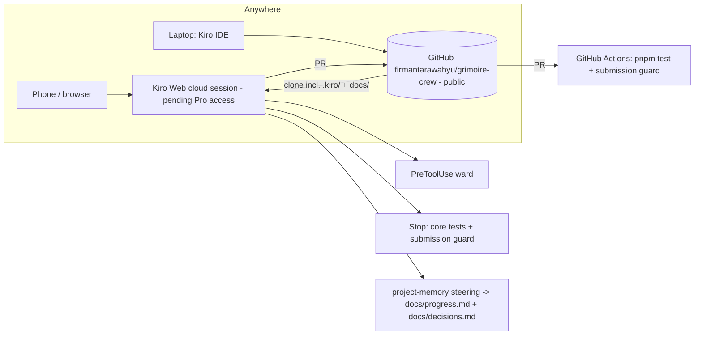

<!-- The Day-1 implementation plan as approved by the user on 2026-11-22, kept verbatim. -->

**Implementation Plan – GrimoireCrew Day 1: Repo Scaffold, `.kiro/` Discipline, Cloud-Ready Setup, Spec 01**

Communication: talk to the user in Bahasa Indonesia. Write all repo content (code, steering, specs, docs) in English. The user is new to Kiro, so explain Kiro-specific steps in plain language.

Execution context: the current workspace is `d:\Projects\5. Kiroween` (Windows, pwsh). Create the project at `d:\Projects\5. Kiroween\grimoire-crew\`. The source brainstorming docs are in `d:\Projects\5. Kiroween\1. Brainstorming-Idea\` (`KIRO-HANDOFF.md`, `kiro-crew-schemas.md`, `kiroween-2026-docs.md`). The hooks created under `grimoire-crew/.kiro/` will NOT be active in this session, because they only load from the workspace root. They become active after the user opens `grimoire-crew/` as a workspace.

**Problem Statement:**
Set up `grimoire-crew/` as a pnpm monorepo root that meets the Kiroween 2026 submission rules. That means a public GitHub repo, an MIT license, and a committed `.kiro/` directory. The repo must hold all project context, because the user wants to work from Kiro Web cloud sessions later. Their account is currently on the Free plan, so cloud access is pending. Cloud sessions only see what is committed. Deliverables:
- `.kiro/` steering, hooks, and MCP config
- Spec 01 for `packages/core`
- repo memory docs
- CI

Do not write any implementation code in `packages/` or `apps/` today.

**Requirements (all confirmed by the user):**
1. Git and GitHub:
   - Make `grimoire-crew/` a new git repo on branch `main`, with one commit per task (conventional commit messages).
   - Publish it as a **public** repo `firmantarawahyu/grimoire-crew`. Ask the user before every push.
2. Root files:
   - MIT `LICENSE`: year 2026, holder `firmantarawahyu` (from `git config user.name`) unless the user gives another name. Use the standard MIT text so GitHub detects it.
   - `.gitignore` that never ignores `.kiro/` or any of its subfolders.
   - `.gitattributes` containing `* text=auto eol=lf`.
   - `.env.example` with empty values.
   - `.nvmrc` containing `22`.
   - `pnpm-workspace.yaml`, root `package.json`, `pnpm-lock.yaml`, and `README.md`.
3. Hook triggers and scripts:
   - Hooks may only use triggers that also run on Kiro Web, and this repo uses `PreToolUse` and `Stop`. Do not use `PostFileSave`.
   - Write each hook script test-first.
   - The ward exits 2 only on a positive match. On internal errors it fails open (exit 0 plus a stderr warning).
4. The ward blocks two things:
   - access to `.env*` files, except `.example`, `.sample`, and `.template`
   - shell commands that dump the environment or print secret-named variables
5. Repo memory docs:
   - `docs/brainstorming/`: verbatim copies of the 3 docs, plus a `README.md` stating that `.kiro/steering/kiro-crew-schemas.md` supersedes the brainstorming schema doc
   - `docs/planning/2026-11-22-day-1-plan.md`: this plan, verbatim
   - `docs/decisions.md`: decision log
   - `docs/progress.md`: living status
   - `docs/working-with-kiro.md`: primer for a first-time Kiro user
6. Steering files:
   - `architecture.md`
   - `kiro-crew-schemas.md`
   - `security-zero-secret.md`
   - `alchemist-ui-audio.md`
   - `project-memory.md`: `always`, references `docs/progress.md` and `docs/decisions.md` via `#[[file:…]]`
   - `session-handoff.md`: `manual`, so it shows up as the `/session-handoff` slash command

   The agent drafts the steering content. The user will review it later, so list the review questions in `docs/progress.md` under "Open questions".
7. Arch-Familiar: display name **Vesper**, stable ID `grimoire-arch-familiar`. The display name must be configurable through a single constant.
8. Spec 01 at `.kiro/specs/01-core-schema-and-compiler/` with `requirements.md` (EARS), `design.md`, and `tasks.md` (Kiro checkbox format). Scope:
   - Zod schema, structural linter, security linter
   - compiler targets `crew-app` and `kiro-workspace`
   - importer: strict round-trip for GrimoireCrew output, best-effort for foreign files. Importer tasks go last.
9. Model fields: `kiroModel` is optional, compiled to agent `model`, and omitted when empty. `runtimeModel` is used only by Mode A and stored in the `grimoire.studio.json` sidecar.
10. Compile mappings for the workspace target:
    - SOP → `.kiro/steering/grimoire-<ritual>-sop.md` with `inclusion: manual`, also referenced in the conductor's `resources`
    - cron ritual → lint warning, skipped
    - webhook relic → runtime-only in both targets: listed in the SOP relic table, with an info diagnostic
11. Toolchain: pnpm, Node ≥ 22.12, TypeScript strict, Vitest (`vitest run` only), fast-check, Zod 4, `yaml`. No Bun.
12. GitHub Actions CI runs on every PR and on pushes to `main`.
13. The Kiro account is on the Free plan, and Kiro Web requires Pro or higher. The cloud part of Task 7 is deferred and logged as a blocker in `docs/progress.md`, with these follow-ups:
    - Check whether the 4,000 hackathon credits (claim deadline Dec 1, 2026, via the Devpost Resources tab) include Kiro Web access, or upgrade.
    - Unverified fallback: GitHub Codespaces with Kiro CLI in the browser terminal.

**Background (verified 2026-11-22, cite these URLs in steering):**
- **Cloud sessions** ([/cloud-sessions](https://kiro.dev/docs/cloud-sessions/), [guide](https://kiro.dev/docs/guides/running-kiro-in-the-cloud/), [/web/sandbox](https://kiro.dev/docs/web/sandbox/), [/web](https://kiro.dev/docs/web/)):
  - Kiro clones the repo server-side, and `.kiro/` project config applies automatically. The laptop's `~/.kiro` is never available.
  - The agent opens PRs and never pushes to `main`.
  - Network levels: repo-only, common dependencies, or open internet, plus an optional custom allow-list.
  - Secrets are encrypted and injected into the sandbox as environment variables.
  - There is no Supervised mode. Up to 10 parallel sessions. Sessions persist and can be resumed from Web, Mobile, IDE, or CLI.
  - Requires the Pro plan or higher.
- **Hooks** ([/hooks](https://kiro.dev/docs/hooks/), [/hooks/types](https://kiro.dev/docs/hooks/types/), [/hooks/actions](https://kiro.dev/docs/hooks/actions/)):
  - Fields: `version: "v1"`, `hooks[].name` (required), `description`, `trigger` (PascalCase), `matcher`, `action{type:"command",command}|{type:"agent",prompt}`, `timeout` (seconds, default 60), `enabled`, `confirm` (Stop only).
  - On PreToolUse, any non-zero exit blocks the tool and stderr goes to the agent. On exit 0, stdout is added to the agent's context.
  - STDIN JSON includes `hook_event_name`, `cwd`, `session_id`, `tool_name`, and `tool_input`. MCP tool IDs have the form `mcp_<server>_<tool>`.
  - Matcher options: `read`, `write`, `shell`, `web`, `spec`, `@mcp`, `@<server>`, `@<server>/<tool>`, a regex against the tool ID, or a `*`/`?` wildcard.
  - Kiro Web runs only Prompt Submit, Agent Stop, Session Start, Pre Tool Use, and Post Tool Use.
- **Steering** ([/steering](https://kiro.dev/docs/steering/)):
  - Front matter `inclusion` modes: `always`; `fileMatch` with `fileMatchPattern` (string or array); `manual` (appears as a slash command); `auto` with `name` and `description`.
  - Whole-file `#[[file:path]]` references work on every surface.
- **Permissions** ([/permissions](https://kiro.dev/docs/permissions/)):
  - Capabilities: `fs_read`, `fs_write`, `shell`, `web_fetch`, `web_search`, `mcp`, `subagent`, `skill`, `power`, `context`, `diagnostics`, `sandbox_network`.
  - Effects: allow, ask, deny. Rules can have `exclude` globs. Deny overrides all other effects.
  - Agent writes to `.kiro/settings/` are always denied. Writes to `.kiro/hooks` and `.kiro/agents` always ask.
  - An untrusted workspace does not load steering, hooks, or MCP.
  - `permissions.yaml` does not apply on Web.
- **Agent config** ([/custom-agents/configuration-reference](https://kiro.dev/docs/custom-agents/configuration-reference/)):
  - Fields: `name`, `description`, `prompt`, `model`, `tools` (selectors), `excludedTools`, `permissions.rules` (capability names, `match`, `effect`, `exclude`), `resources` (`file://`, `skill://`, knowledgeBase), `hooks` (inline, CLI V3), `mcpServers`, `includeMcpJson`, `includePowers`, `welcomeMessage`.
  - Agents can also be written as Markdown with front matter.
  - Sub-agents are referenced as `subagent/<name>` in `tools`, together with a `subagent` capability rule.
  - If the `model` is unavailable, the first prompt fails.
- **Crew** ([/crew/apps/manifest](https://kiro.dev/docs/crew/apps/manifest/), [/crew/apps/sdk](https://kiro.dev/docs/crew/apps/sdk/), [/crew/apps](https://kiro.dev/docs/crew/apps/)):
  - Manifest fields include `name` (kebab), `version` (semver), `displayName`, `description`, `author`, `license`, `minKiroCrewVersion`, `tags`, `agents[]`, `skills[]`, `sops[]`, `mcpServers{}`, `crons[]` (`name`, `every`|`cron_expr`, `message`, `agent`, `enabled`), `ui{entry,pages[]}`, `permissions{api,events,mcpTools,storage,cron,memory,network,jobs}`, `platform{os}` (defaults to macOS and Linux only), and `iconPath` (PNG, at least 256×256).
  - Paths must stay inside the app root. Unknown fields are preserved. There is no Kiro-hooks field.
  - `@kirocrew/app-sdk` is provided by the host import map at runtime. It is not an npm dependency.
- **Observed locally** in the first-party Crew app `personal-shopper` 0.1.2 (`~/.kiro/crew/app-sources/personal-shopper/agents/advisor.json`): `"skills": ["personal-shopper"]` (a top-level agent field, not documented), `"tools": ["web_search","web_fetch"]`, `"model": "auto"`, `"includeMcpJson": false`, `"mcpServers": {}`, and no `permissions` block. Kiro Crew is installed on the user's laptop with 24 apps. Use it for Spec 05 verification.
- **Skills** ([/skills](https://kiro.dev/docs/skills/)): workspace skills live at `.kiro/skills/<name>/SKILL.md`, with front matter `name` and `description`.
- **Specs** ([/specs](https://kiro.dev/docs/specs/), [/specs/feature-specs](https://kiro.dev/docs/specs/feature-specs/), [/specs/correctness](https://kiro.dev/docs/specs/correctness/)):
  - Requirements use EARS ("WHEN … THE SYSTEM SHALL …").
  - Tasks are run in dependency waves.
  - The PBT UI is IDE-only, and PBT tasks are optional by default (marked `- [ ]*`).
- **Unverified, deferred to Spec 05 (laptop with local Crew):**
  - whether Crew honors agent `permissions.rules`
  - whether inline agent hooks run under Crew, and from which cwd
  - the `skill://` form for app-bundled skills. The plan uses the observed `"skills": [...]` field instead.

**Proposed Solution:**

Zero-secret defense layers. Document these in `security-zero-secret.md`:
1. Add no sandbox secrets until Spec 04. From Spec 04, use a dedicated OpenRouter key.
2. Use the "Common dependencies" network level. Add an allow-list in Spec 04 (`openrouter.ai`, `api.github.com`, `raw.githubusercontent.com`, `discord.com`).
3. The PreToolUse ward, covering `.env*` files and environment dumps.
4. Deny rules on every compiled agent (Spec 01).
5. Runtime redaction (Spec 03/04).
6. Local only: a personal `permissions.yaml` deny rule (`fs_read` deny `["**/.env","**/.env.*"]`).

The ward is a guard rail, not a security boundary. For example, an agent could write a script that prints a secret and then run it. Write this down as a known residual risk.

**Spec 01 design blueprint (content for `design.md`):**
- **Platform-neutral core.**
  - No `node:` imports, fs, network, or DOM in `packages/core/src`. Core's tsconfig uses `types: []` and `lib: ["ES2023"]`, so Node usage fails typecheck. Tests may use Node.
  - Inputs and outputs use `FileMap = Record<string, string>`, sorted by path on emit.
  - Internal package: `exports` points at `src/index.ts`, `moduleResolution: Bundler`, no build step.
  - Dependencies: `zod` (v4) and `yaml`. Dev dependencies: `vitest`, `fast-check`, `typescript`, and `@types/node` (tests only).
- **Graph model.**
  - Graph fields: `schemaVersion: 1`, `slug` (kebab; app name becomes `grimoire-<slug>`), `displayName`, `description`, `author`, `version` (semver), `nodes[]` (discriminated union on `type`), and `edges[]` (`id`, `source`, `target`).
  - Node `id` is a kebab slug, unique within the graph. It is also used in file names, so the importer can recover it.
  - Node types:
    - `manual_ritual`: `inputKind` (`prompt | url | text`)
    - `cron_ritual`: `cron` (5-field) or `everySeconds`, plus `message` and `enabledOnInstall` (default `false`)
    - `conductor`: `name`, `goal`, `kiroModel?`, `maxSteps`
    - `worker_agent`: `reuse` mode (`existingAgentName`, no file emitted) or `custom` mode (`persona`, `task`, `kiroModel?`, `maxSteps` 3–5, `outputFormat` `markdown | json`)
    - `skill_tome`: `slug`, `description`, `template` (one of 4 built-ins or `custom`), `body`
    - `builtin_relic`: `relic` (`github_repo_reader | web_page_fetcher | webhook_notifier`), `retry{attempts, backoffMs}`, `fallback` (`skip | abort | cached`), `allowedHosts`
    - `custom_mcp_relic`: `serverName`, plus either local `{command, args, env}` or remote `{url, headers}`, plus `autoApprove` and `disabledTools`
    - `ward_hook`: `trigger` (`PreToolUse | PostToolUse`), `matcher`, and toggles `promptInjectionFilter`, `secretLeakBlocker`, `permissionAllowlistGate`
- **Sidecar `grimoire.studio.json`.** Holds `schemaVersion`, node positions, viewport, per-node `runtimeModel`, and manual-ritual default inputs. It contains only studio data that has no Kiro equivalent.
- **Edge matrix.**
  - trigger → conductor or worker
  - conductor → worker
  - agent → skill or relic
  - ward → agent
  - At most one conductor per graph. Every agent must be reachable from a trigger.
- **Diagnostics.** Shape: `{ code: "GC-E001", severity: "error" | "security" | "warning" | "info", nodeId?, message, fix? }`. Codes are stable, and `fix` is a hint for the later Vesper auto-heal.
- **Security linter.**
  - These secret patterns produce `security` errors that block compile: `sk-…` (including `sk-or-v1-`), `ghp_`, `gho_`, `github_pat_`, `AKIA[0-9A-Z]{16}`, `xox[baprs]-`, PEM private-key headers, Discord webhook URLs, and the canary `sk-kiro-CANARY-FAKE-`.
  - MCP `env` and `headers` values must contain a `${VAR}` placeholder and no secret-like literal.
- **Agent prompt layout.**
  - Workers use fixed headings: `## Persona`, `## Task`, `## Output Format`, `## Limits` (carries `maxSteps`).
  - The conductor uses `## Goal`, `## Delegation`, `## Work Ledger`.
- **Baseline rule on every compiled agent:** `{capability:"fs_read", match:["**/.env","**/.env.*"], exclude:["**/.env.example"], effect:"deny"}`.
- **Mapping table.**

  | Node | crew-app | kiro-workspace |
  |---|---|---|
  | manual_ritual | SOP trigger table | SOP trigger table |
  | cron_ritual | `app.json` `crons[]` (with `enabled` from `enabledOnInstall`) + SOP | SOP only + warning |
  | conductor / custom worker | `agents/grimoire-<id>.json` | `.kiro/agents/grimoire-<id>.json` |
  | conductor delegation | `tools` gets `subagent/<worker>` + `subagent` allow rule | same |
  | reuse worker | referenced by name only | same |
  | skill_tome | `skills/<slug>/SKILL.md` + agent `"skills": ["<slug>"]` (observed pattern) | `.kiro/skills/<slug>/SKILL.md` + `resources: ["skill://.kiro/skills/<slug>/SKILL.md"]` |
  | github / web relic | `tools: ["web_fetch"]` + `web_fetch` allow rules for hosts, `permissions.network: true` | `tools: ["web_fetch"]` + `web_fetch` allow rules |
  | webhook relic | runtime-only: SOP relic table + info diagnostic | same |
  | custom_mcp_relic | `app.json` `mcpServers` + `tools: ["@<server>"]` | `.kiro/settings/mcp.json` + `includeMcpJson: true` + `@<server>` |
  | ward_hook | deny rules (`secretLeakBlocker` = baseline plus `.pem` and `*secret*` denies; `permissionAllowlistGate` = `deny web_fetch "*"` with `exclude` set to the allowed hosts); `promptInjectionFilter` = info diagnostic (runtime-only) | same deny rules + `.kiro/hooks/grimoire-wards.json` (v1) + `scripts/grimoire-ward-guard.mjs` called with flags (`--secret --injection --allow-host <h>`) |
  | SOP | `sops/<ritual>.md` | `.kiro/steering/grimoire-<ritual>-sop.md` (`inclusion: manual`) + conductor `resources` |

- **`app.json` derived fields.** `permissions: { api: [], events: [], network: <true if any network relic or remote MCP> }` and `platform.os: ["macos","linux","windows"]`. Omit `iconPath` and emit an info diagnostic.
- **SOP format.**
  - Sections: `## Trigger`, `## Handoff Order`, `## Topology` (from/to table), `## Relics` (id, kind, retry, backoffMs, fallback, hosts), `## Wards` (id, trigger, matcher, toggles), `## Deliverable`.
  - In table cells, escape `|` as `\|` and newlines as ` `.
- **Determinism.**
  - JSON keys follow the field order in the official docs. 2-space indent, LF line endings, trailing newline.
  - No timestamps and no random values.
  - Handoff order is topological with an ID tiebreak. Other arrays are sorted by ID.
- **Importer.** `importFiles(files: FileMap) → { graph, studio?, passthrough, diagnostics }`.
  - Detect the target: `app.json` means crew-app; `.kiro/` means workspace.
  - Files with the `grimoire-` prefix and the structured headings become full nodes.
  - Foreign agents (JSON or Markdown) become `reuse` workers.
  - Foreign hooks, steering, and unknown fields go to passthrough with an info diagnostic.
  - Without a sidecar, apply a deterministic layered auto-layout.
- **Correctness properties.** Use the format "Property N: *For any* …, **Validates: Requirements X.Y**".
  - P1: compile is deterministic and independent of node and edge array order.
  - P2: every emitted file validates against the target contract Zod schemas.
  - P3: no emitted file matches a secret pattern, and every env/header value is a placeholder.
  - P4: `import(compile(g,t)) ≡ normalize(g)` for both targets when the sidecar is present. Without the sidecar, the result equals the graph minus studio fields.
  - P5: any lint error means zero files are emitted.
  - P6: a secret injected into any text field makes compile fail with a `security` diagnostic.
- **Spec 01 task outline for `tasks.md`.** Each task carries `_Requirements: X.Y_`. PBT tasks are NOT marked optional.
  1. Package scaffold `packages/core`, with smoke test and the `test` and `test:hook` (`vitest run --reporter=dot`) scripts
  2. Graph and sidecar Zod schemas, plus a fast-check `arbGraph`
  3. Target contract schemas, with doc examples copied verbatim as fixtures (source URL comments)
  4. Structural linter
  5. Security linter (P6)
  6. Deterministic writers: JSON, front matter, escaped Markdown tables (P1 partial)
  7. 3 preset graphs as data: PR Exorcist Coven, Thesis Alchemist, Bug Necromancer
  8. Agent and skill emitters
  9. SOP emitter and ward guard template, with a child-process exit-code test
  10. `crew-app` target and golden snapshots
  11. `kiro-workspace` target and golden snapshots (P2, P3, P5)
  12. Per-file parsers
  13. Import assembly, passthrough, and auto-layout
  14. Round-trip property tests (P4) and public `index.ts`
  15. Regenerate this repo's `scripts/grimoire-ward-guard.mjs` from the core template using secret-only flags, then confirm the Day-1 ward tests still pass

**Task Breakdown:**

Task 1: Repo skeleton
- Objective: create `grimoire-crew/` with the root files from Requirement 2, run `git init -b main`, and make the first commit.
- Guidance:
  - Check `node --version` (must be ≥ 22.12) and `pnpm --version`. If pnpm is missing, ask the user to run `corepack enable pnpm`.
  - Root `package.json`:
    - `name: "grimoire-crew"`, `private: true`, `"type": "module"`, `license: "MIT"`, `engines.node: ">=22.12"`, and `packageManager` set to the installed pnpm version.
    - Scripts: `test` = `pnpm -r --if-present test && pnpm test:scripts`; `typecheck` = `pnpm -r --if-present typecheck`; `test:scripts` = `node --test` over `scripts/test/`. Verify the exact invocation works in both pwsh and bash.
  - `pnpm-workspace.yaml`: `packages/*`, `apps/*`.
  - `.gitignore`: `node_modules/`, `dist/`, `coverage/`, `*.log`, `*.tsbuildinfo`, `.vite/`, `.DS_Store`, `Thumbs.db`, `.env`, `.env.*`, `!.env.example`. No `.kiro` entry and no `.*` pattern.
  - `.env.example`: a "copy to .env locally, never commit .env" comment, then `OPENROUTER_API_KEY=`, `GITHUB_TOKEN=`, `GRIMOIRE_WEBHOOK_URL=`.
  - `README.md`: a stub, to be expanded in Task 6.
  - Run `pnpm install` to generate the lockfile. Do not create `packages/` or `apps/`.
  - Commit `chore: scaffold monorepo root`.
- Tests:
  - `git check-ignore -q .kiro/steering/x.md` exits 1.
  - `git check-ignore -q .env.example` exits 1.
  - `git check-ignore -q .env` exits 0.
- Demo: `git log --oneline` shows one commit, and the check-ignore results are as expected.

Task 2: Ward guard script (test-first)
- Objective: `scripts/grimoire-ward-guard.mjs`, zero dependencies.
- Guidance:
  - Write `scripts/test/grimoire-ward-guard.test.mjs` first, using `node:test` and `spawnSync` with JSON piped to STDIN.
  - Read STDIN fully and parse it. Walk `tool_input`, and inspect only:
    - path-like keys matching `/path|file|dir|uri|pattern|target|source|cwd/i`
    - command keys `command` and `script`
  - Rule A (`.env` file): a token whose basename is `.env` or `.env.<x>`, excluding `.example`, `.sample`, `.template`. Tokens are delimited by start of string, whitespace, quotes, `/`, `\`, `=`, or any of `;|&()`.
  - Rule B (environment exposure), checked in command keys only:
    - bare `printenv`, bare `env` (not followed by a `VAR=value` assignment), `export -p`, or bare `set`
    - `/proc/<anything>/environ`
    - `Get-ChildItem env:`, `gci env:`, `dir env:`
    - `$NAME`, `${NAME}`, `$env:NAME`, or `printenv NAME`, where NAME matches `[A-Z0-9_]*(API_KEY|TOKEN|SECRET|PASSWORD|PRIVATE_KEY|ACCESS_KEY)[A-Z0-9_]*`
  - On a hit: write `[WARD BLOCKED] <rule description> denied by grimoire-env-secret-ward` to stderr and exit 2. Never echo the value or the full path.
  - On an internal error: write a warning to stderr and exit 0.
  - On success: print nothing.
  - Commit `feat(scripts): add env secret ward guard`.
- Tests (all must pass):
  - Must exit 2:
    - `{path:".env"}`
    - `{path:"apps/server/.env.local"}`
    - shell `cat .env`
    - `Get-Content .\.env`
    - `node --env-file=.env x.js`
    - MCP input `{file:".env.production"}`
    - `printenv`
    - `printenv OPENROUTER_API_KEY`
    - `env | grep KEY`
    - bare `set`
    - `cat /proc/self/environ`
    - `Get-ChildItem env:`
    - `echo $OPENROUTER_API_KEY`
    - `echo "${GITHUB_TOKEN}"`
    - `$env:OPENROUTER_API_KEY`
  - Must exit 0:
    - `.env.example`
    - a command containing `process.env.FOO`
    - grep `{query:".env"}`
    - `env NODE_ENV=test pnpm test`
    - `set -euo pipefail`
    - `echo $HOME`
    - `pnpm test`
    - invalid JSON (with a stderr warning)
    - empty STDIN
- Demo: `pnpm test:scripts` passes. Piping a sample payload by hand shows exit 2 and exit 0.

Task 3: Submission guard script (test-first)
- Objective: `scripts/kiro-submission-guard.mjs`, silent on success.
- Guidance:
  - Call git with `execFileSync('git', [...])` and no shell. Accept `--root <dir>` (default `process.cwd()`).
  - Checks:
    1. `git check-ignore` reports none of `.kiro`, `.kiro/specs`, `.kiro/steering`, `.kiro/hooks`, `.kiro/settings/mcp.json` as ignored.
    2. `LICENSE` exists and contains "MIT License".
    3. `git ls-files` lists no `.env` or `.env.*` file other than `.env.example`.
    4. If `.kiro/settings/mcp.json` exists, every `env` and `headers` value contains `${…}` and matches no secret pattern.
  - On failure: write one stderr line per violation and exit 1. Outside a git repo: write "not a git repository: run git init" and exit 1.
  - Commit.
- Tests: create temporary git repos with `fs.mkdtemp` and `git init`.
  - A clean repo exits 0.
  - Each of these exits 1 with the right message: `.kiro/` in `.gitignore`, `.*` in `.gitignore`, missing LICENSE, tracked `.env`, literal token in `mcp.json` env.
- Demo: on this repo the guard exits 0 with no output. On a broken temp repo it prints clear messages.

Task 4: Core-test hook runner and the 3 hook files
- Objective: `scripts/hook-core-tests.mjs` (test-first), `.kiro/hooks/env-secret-ward.json`, `.kiro/hooks/compiler-schema-test.json`, `.kiro/hooks/kiro-submission-guard.json`, and `scripts/test/kiro-config.test.mjs`.
- Guidance:
  - `hook-core-tests.mjs`, in order:
    1. If `packages/core/package.json` is missing, exit 0 silently.
    2. If `git status --porcelain -- packages/core` is empty, exit 0 silently.
    3. If `node_modules` is missing, write "run pnpm install --frozen-lockfile" to stderr and exit 1.
    4. Otherwise run the constant command `pnpm --filter @grimoire-crew/core test:hook` (use `shell: true` so `pnpm.cmd` works on Windows). On failure, write the last ~60 output lines to stderr and exit 1. On success, print nothing.
    5. With `GRIMOIRE_HOOK_DRY_RUN=1`, print the command instead of running it. Tests use this.
  - `env-secret-ward.json`: 3 `PreToolUse` entries with matchers `read`, `shell`, and `@mcp`. Command `node scripts/grimoire-ward-guard.mjs`, timeout 10.
  - `compiler-schema-test.json`: trigger `Stop`, command `node scripts/hook-core-tests.mjs`, timeout 180.
  - `kiro-submission-guard.json`: trigger `Stop`, command `node scripts/kiro-submission-guard.mjs`, timeout 30.
  - Every entry has a `name` prefixed `grimoire-`, a `description`, and `enabled: true`.
  - Tell the user to expect a Kiro approval prompt for each hook file write.
  - `kiro-config.test.mjs` (zero dependencies) checks every `.kiro/hooks/*.json`:
    - `version === "v1"` and the required fields are present
    - `trigger` is in the cloud-supported set `{PreToolUse, PostToolUse, Stop, SessionStart}`
    - `action.type` is `command` (with `command`) or `agent` (with `prompt`)
    - `timeout` is numeric
    - every referenced `node scripts/*.mjs` file exists
  - Commit.
- Tests:
  - Dry-run cases: no core package, no changes, changes present, Windows-style path.
  - The config test passes, and fails when one trigger is temporarily changed to `PostFileSave`. Revert the change afterwards.
- Demo: `pnpm test:scripts` passes, and the hook JSON is shown to the user.

Task 5: MCP config and steering files
- Objective: `.kiro/settings/mcp.json` and the 6 steering files, covered by the config test.
- Guidance:
  - `mcp.json` content is `{ "mcpServers": {} }` plus a newline. If Kiro refuses the write (agent writes to `.kiro/settings/` are hard-denied), stop and give the user the exact content to create manually.
  - `architecture.md` (`inclusion: always`):
    - mission one-liner; companion, not wrapper; bootstrap from existing Kiro/Crew state; `grimoire-*` namespacing
    - monorepo layout and package boundaries:
      - core is pure and uses FileMap
      - `packages/ui` depends only on core and a `HostAdapter` interface
      - `apps/crew-app` is the only `@kirocrew/app-sdk` consumer (Vite external plus a local `.d.ts` shim)
      - `apps/server` uses Hono and SSE
      - `apps/web` uses Vite
    - toolchain (Requirement 11); naming `@grimoire-crew/*`; the Vesper/ID rule; spec order (01 core, 02 studio UI, 03 curse engine, 04 server runtime and Arch-Familiar, 05 Crew App and verification)
    - spec-before-code rule; determinism conventions
    - cross-platform path regexes (accept both `\` and `/`); LF line endings; `vitest run` only
    - in a fresh sandbox, run `pnpm install --frozen-lockfile` first
    - a red Stop-hook report during the TDD red phase is expected; never loop on it more than once; report to the user instead
  - `kiro-crew-schemas.md` (`inclusion: fileMatch`, `fileMatchPattern: ["packages/core/**","apps/crew-app/**"]`): the corrected reference from the Background section, with source URLs, the verification date 2026-11-22, the observed `personal-shopper` agent pattern, and an explicit "Unverified" list.
  - `security-zero-secret.md` (`inclusion: always`):
    - the invariant and the six layers; the ward is a guard rail, not a boundary (residual risk)
    - canary format `sk-kiro-CANARY-FAKE-…`; test secrets exist only as in-memory strings, never as real `.env` fixture files
    - `${VAR}` placeholders only; the OpenRouter key stays server-side and never enters the browser bundle
    - no sandbox secrets until Spec 04
    - prompt-injection detection belongs to the runtime ward (Spec 03), not the dev hook
    - local-only `permissions.yaml` tip
  - `alchemist-ui-audio.md` (`inclusion: fileMatch`, `fileMatchPattern: ["packages/ui/**","apps/web/**","apps/crew-app/**"]`):
    - 2D only (no Three.js or WebGL); `@xyflow/react`; animated SVG and CSS candlelight
    - candlelight states: gold = idle, cyan/violet = active conductor, red plus subtle shake = curse/breach
    - procedural WebAudio events: `agent_thinking`, `tool_called`, `ward_blocked`, `curse_breached`, `ritual_complete`; ambience; mute and volume controls
    - the AudioContext stays muted until the first user gesture (browser autoplay policy)
    - `prefers-reduced-motion` disables shake and pulse effects
    - budget: ~50–80 MB RAM at 60 fps; keyboard access and contrast requirements
  - `project-memory.md` (`inclusion: always`):
    - `Current status: #[[file:docs/progress.md]]` and `Decision log: #[[file:docs/decisions.md]]`
    - rules: read both before starting work; never contradict a logged decision without asking the user; log new decisions tersely; end every session with `/session-handoff`
  - `session-handoff.md` (`inclusion: manual`). Steps:
    1. Run `pnpm test`.
    2. Update `docs/progress.md` (Done / In progress / Next / Open questions / Blockers).
    3. Append new decisions to `docs/decisions.md`.
    4. Commit with a conventional message.
    5. On Kiro Web, write a PR summary that references spec task IDs.
  - Extend `kiro-config.test.mjs` to check:
    - every steering file has front matter, and `inclusion` is one of always/fileMatch/manual/auto
    - `fileMatch` files have `fileMatchPattern`; `auto` files have `name` and `description`
    - every `#[[file:…]]` target exists. Task 6 creates these targets; until then, temporary stubs for `docs/progress.md` and `docs/decisions.md` are acceptable.
    - no steering file matches a secret pattern
    - `mcp.json` parses and has `mcpServers`
  - Commit.
- Tests: `pnpm test:scripts` passes, and the submission guard exits 0.
- Demo: the `.kiro/` tree with front matter shown.

Task 6: Repo memory docs and CI
- Objective: everything in Requirement 5, a fuller `README.md`, and `.github/workflows/ci.yml`.
- Guidance:
  - Copy the 3 brainstorming docs byte-for-byte into `docs/brainstorming/`. Add a `README.md` there saying the steering version of `kiro-crew-schemas.md` supersedes the brainstorming one, and that Bun is replaced by pnpm with Vitest.
  - Write this plan verbatim to `docs/planning/2026-11-22-day-1-plan.md`.
  - `docs/decisions.md`: one entry per decision, with date, decision, why, and rejected alternatives. Entries:
    - full TypeScript pnpm monorepo
    - 2D-only UI
    - Vesper and its stable ID
    - `grimoire-crew/` as git root, with brainstorming docs copied
    - Spec 01 scope includes the importer (strict vs best-effort, importer last)
    - studio sidecar
    - `kiroModel` / `runtimeModel`
    - SOP as manual steering; cron produces a warning
    - webhook relic is runtime-only
    - cloud-compatible hook triggers (PreToolUse and Stop)
    - ward scope (`.env` files and environment dumps)
    - deny rules as the primary compiled defense layer
    - observed Crew agent `skills` field
    - public repo from day 1
    - CI on PRs
    - pnpm + Vitest, no Bun
  - `docs/progress.md`:
    - Done: Day 1 items so far.
    - Next: Spec 01 docs, then Spec 01 task 1.
    - Open questions: steering review items for the user; unverified Crew items for Spec 05; scope-cut discussion after Spec 01.
    - Blockers: Kiro Web requires Pro. Claim the hackathon credits before Dec 1 and check whether they cover Kiro Web, or upgrade. Fallback idea, unverified: GitHub Codespaces with Kiro CLI.
  - `docs/working-with-kiro.md` (plain language, for a first-time Kiro user):
    - what steering, hooks, specs, and slash commands each do in this repo, one short paragraph per steering file and hook
    - how to edit steering
    - cloud workflow: app.kiro.dev → attach the repo → work → `/session-handoff` → review the PR (green CI check) and merge, from a phone if needed → start the next session only after merging, or resume the same session
    - avoid parallel sessions on the same files; run `git pull` before local work
    - environment setup: "Common dependencies" network, no secrets until Spec 04
  - `README.md`: one-liner, Day-1 status, prerequisites (Node ≥ 22.12, pnpm), `pnpm install` and `pnpm test`, how the repo uses Kiro (links to `.kiro/` and `docs/working-with-kiro.md`), and the MIT license.
  - `.github/workflows/ci.yml`:
    - triggers: `pull_request`, and `push` on `main`; `permissions: contents: read`; runner `ubuntu-latest`
    - steps: `actions/checkout@v4`, `pnpm/action-setup@v4` (reads `packageManager`), `actions/setup-node@v4` with `node-version-file: .nvmrc` and `cache: pnpm`, then `pnpm install --frozen-lockfile`, `pnpm typecheck`, `pnpm test`, `node scripts/kiro-submission-guard.mjs`
  - Commit.
- Tests: the config test confirms every `#[[file:…]]` target exists, `pnpm test:scripts` passes, the submission guard passes, and the CI YAML parses (use `node -e` with a minimal check, or review it).
- Demo: `docs/` is complete. A new reader can follow `working-with-kiro.md`.

Task 7: Publish to GitHub (Kiro Web setup deferred)
- Objective: a public repo `firmantarawahyu/grimoire-crew` with a CI run.
- Guidance:
  - Check `gh --version` and `gh auth status`.
    - If both work: after the user confirms, run `gh repo create firmantarawahyu/grimoire-crew --public --source . --push --description "<one-liner>"`.
    - If not: ask the user to create an empty public repo on github.com (no README, license, or .gitignore). Then run `git remote add origin https://github.com/firmantarawahyu/grimoire-crew.git` and, after confirmation, `git push -u origin main`.
  - Confirm that GitHub detects the MIT license and that the CI workflow ran green (`gh run list`, or ask the user to check).
  - Because the account is on the Free plan, record the Kiro Web steps in `docs/working-with-kiro.md` for later instead of doing them now:
    1. Connect GitHub scoped to this repo.
    2. Settings → Environments → "Common dependencies", no secrets.
    3. Smoke test: `pnpm install --frozen-lockfile && pnpm test:scripts`; `printenv` must be blocked; ask what `docs/progress.md` says to prove the project-memory steering loads; if hooks don't load (for example, workspace trust), log it as a blocker.
  - Update `progress.md`. Commit and push after confirmation.
- Demo: the public repo shows `.kiro/`, `docs/`, the MIT license badge, and a green CI run.

Task 8: Spec 01 `requirements.md` (review gate)
- Objective: EARS requirements in Kiro's layout. Sections: Introduction, Glossary, and Requirements. Each requirement has `### Requirement N`, a `**User Story:** As a …, I want …, so that …`, and `#### Acceptance Criteria` as numbered `WHEN … THE SYSTEM SHALL …` lines.
- Guidance:
  - Cover these areas: graph schema; structural linter; security linter and zero-secret outputs; determinism; `crew-app` target; `kiro-workspace` target; ward guard template; importer (strict and best-effort); round-trip; studio sidecar; platform-neutral core; stable diagnostics.
  - Every acceptance criterion must be testable and consistent with the blueprint.
  - Show the user a summary in Bahasa Indonesia and wait for approval before Task 9. Update `progress.md`, commit, and push after confirmation.
- Demo: once the user opens `grimoire-crew/` as a workspace, the file appears in the Kiro Specs view.

Task 9: Spec 01 `design.md` (review gate)
- Objective: the design from the blueprint.
- Guidance:
  - Sections: Overview, Architecture (mermaid), Components and Interfaces (`lint`, `compile`, `importFiles`, writers, parsers), Data Models, Target Mapping tables, Security Rules, Determinism Rules, Correctness Properties P1–P6 (each with "Validates: Requirements X.Y"), Error Handling, Testing Strategy (unit, golden, property), and Open Verification Items for Spec 05.
  - Wait for user approval before Task 10. Update `progress.md`, commit, and push after confirmation.
- Demo: every property links to at least one requirement.

Task 10: Spec 01 `tasks.md`
- Objective: the 15-task outline in Kiro checkbox format: `- [ ] N. Title`, optional `- [ ] N.M Subtask`, detail bullets, and `_Requirements: X.Y_`.
- Guidance:
  - Each task builds on the previous one and ends integrated through `src/index.ts`. Importer tasks come last. PBT tasks are not marked optional (no `*`).
  - Task 1 must define the `test:hook` script that the Stop hook calls.
  - Update `progress.md`, commit, and push after confirmation.
- Demo: the Specs panel lists the tasks with Start buttons, in the IDE once `grimoire-crew/` is the workspace.

Task 11: Verification and handoff
- Objective: prove Day 1 is complete and tell the user what to do next.
- Guidance:
  - Run `pnpm test`, `pnpm typecheck`, and the submission guard. Show `git log --oneline` and the final tree.
  - Follow the `/session-handoff` steps: tests, `progress.md`, `decisions.md`, commit. Push after confirmation.
  - Give the user these next steps in Bahasa Indonesia:
    1. Open `grimoire-crew/` as the Kiro workspace and choose Trust.
    2. Optionally create a dummy `.env` by hand and ask Kiro to read it, to see the ward block it. The agent must not create it.
    3. Claim the Kiroween credits on Devpost before Dec 1 and check Kiro Web access.
    4. Start Spec 01 implementation with "Execute task 1 of spec 01-core-schema-and-compiler".
- Demo: GitHub `main` contains the full `.kiro/` and `docs/`, CI is green, and `progress.md` names the next step.

**Operational rules for execution:**
- Ask before every `git push` and before creating the GitHub repo.
- Never create, read, or print a real `.env` file or any secret.
- Do not touch anything outside `d:\Projects\5. Kiroween\grimoire-crew\`. The one exception is reading the source brainstorming docs.
- Stop at the review gates in Tasks 8 and 9.
- If a write to `.kiro/settings/` is refused, give the user the content to create it manually.
- Expect approval prompts for writes to `.kiro/hooks/`.
